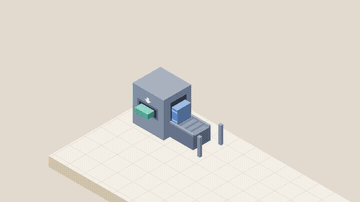
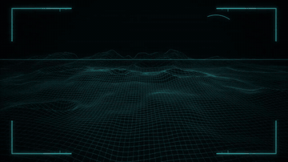
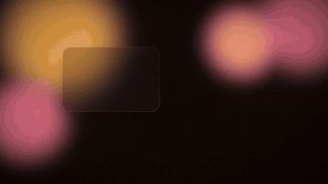
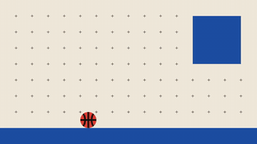
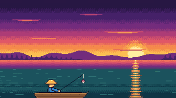
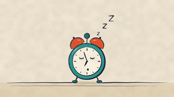
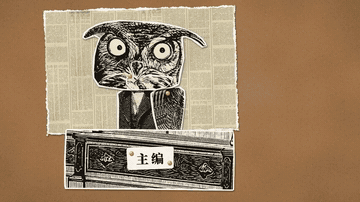
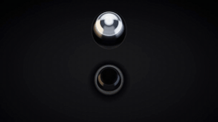
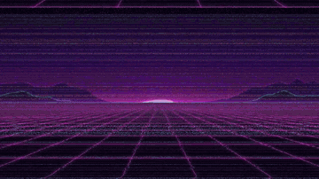
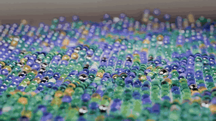

<h1 align="center">mg-video</h1>

<p align="center">
  <em>用代码做精致的 MG 动画短片，十五种成熟画风任选。</em>
</p>

<p align="center">
  <sub><a href="README.md">English</a></sub>
</p>

---

给 agent 用的 skill，做短的 MG（motion graphics）片段：片头、B roll、章节卡、叠在口播画面上的透明花字、独立的短片。agent 不生成视频，它写一个网页，画出第 *t* 秒的画面（Canvas、WebGL、SVG、Three.js），或者写一个 Blender 场景，逐帧渲染，再按同一张节拍表铺配乐和合成音效。

和「写一段动画代码」比，这个 skill 多了这些：

- **风格卡**：十五种认得出来的 MG 画风，每张卡三块：`<signature>`（这个风格一眼认出来靠什么）、`<style>`（怎么做，带实测数字）、`<check>`（通常怎么翻车、怎么量）。agent 把它们贴进这次的提示词
- **一张节拍表**：`cues.json` 写钩子、每个元素入场、高潮、结尾停留。网页读它，`audio.py` 按它放音效和配乐，`sync.py` 量每个声音和画面差几毫秒
- **先出关键帧**：6–10 张静帧单独看也要成立，才开始动；改静帧几秒钟，改全片要几分钟
- **确定性渲染**：每一帧只取决于 *t*；`render.mjs` 并行渲染，可选自适应运动模糊和 ProRes 4444 透明输出
- **可量的检查**：`spec.py`、`check.py`、`measure.py`、`sheet.py`、`sync.py` 在编码后的成片上按固定定义量（边距、调色板、色相、响度、高潮位置、每拍变化量、结尾停留的动作、手机宽度下的字号），制作者和评审量出来的数一样
- **独立评审**：一个没参与制作、上下文干净的评审给 8 项打分，每条修改意见写成脚本能量的条件。改到每项 ≥ 7 分、没有致命问题为止

## 十五种画风

每张卡一支做好的 10 秒成片，都是用这个 skill 做出来、按评审循环改过的。点预览图看带声音的 720p MP4；配乐和音效全是 skill 自带的 `mgsound` 合成的。

<table>
<tr>
<td align="center" width="33%"><a href="docs/films/01-paperclip-sticker.mp4"></a><br><b><code>01-paperclip-sticker</code></b><br><sub>白边实物贴纸，一张大桌子一个镜头，图表按真实比例</sub></td>
<td align="center" width="33%"><a href="docs/films/02-flat-vector.mp4"></a><br><b><code>02-flat-vector</code></b><br><sub>扁平几何，弹性入场，一次只有一个主角</sub></td>
<td align="center" width="33%"><a href="docs/films/03-isometric.mp4"></a><br><b><code>03-isometric</code></b><br><sub>标准 30° 等距，按深度排序，组件之间走管道</sub></td>
</tr>
<tr>
<td align="center" width="33%"><a href="docs/films/04-hud.mp4"></a><br><b><code>04-hud</code></b><br><sub>两种色相，线框、扫描、锁定</sub></td>
<td align="center" width="33%"><a href="docs/films/05-glassmorphism.mp4"></a><br><b><code>05-glassmorphism</code></b><br><sub>磨砂卡片浮在流动的彩色光上</sub></td>
<td align="center" width="33%"><a href="docs/films/06-bauhaus.mp4"></a><br><b><code>06-bauhaus</code></b><br><sub>网格，三原色加黑，一拍一个动作</sub></td>
</tr>
<tr>
<td align="center" width="33%"><a href="docs/films/07-variety-captions.mp4"></a><br><b><code>07-variety-captions</code></b><br><sub>多层描边的圆胖字，弹出，情绪符号（综艺花字）</sub></td>
<td align="center" width="33%"><a href="docs/films/08-pixel.mp4"></a><br><b><code>08-pixel</code></b><br><sub>小画布放大，有限调色板，逐帧精灵图</sub></td>
<td align="center" width="33%"><a href="docs/films/09-cel-boil.mp4"></a><br><b><code>09-cel-boil</code></b><br><sub>线条每几帧抖一次，每秒 12 张，手绘特效</sub></td>
</tr>
<tr>
<td align="center" width="33%"><a href="docs/films/10-one-line.mp4"></a><br><b><code>10-one-line</code></b><br><sub>一根线画到底，线变成面</sub></td>
<td align="center" width="33%"><a href="docs/films/11-morph.mp4"></a><br><b><code>11-morph</code></b><br><sub>一个轮廓连续变成另一个</sub></td>
<td align="center" width="33%"><a href="docs/films/12-collage.mp4"></a><br><b><code>12-collage</code></b><br><sub>剪刀剪的边，网点，一顿一顿的动作</sub></td>
</tr>
<tr>
<td align="center" width="33%"><a href="docs/films/13-liquid.mp4"></a><br><b><code>13-liquid</code></b><br><sub>会融合、分裂的液滴</sub></td>
<td align="center" width="33%"><a href="docs/films/14-synthwave.mp4"></a><br><b><code>14-synthwave</code></b><br><sub>条纹夕阳，霓虹网格，镀铬字，录像带质感</sub></td>
<td align="center" width="33%"><a href="docs/films/15-3d-material.mp4"></a><br><b><code>15-3d-material</code></b><br><sub>真实材质，柔光，浅景深（Blender + Cycles）</sub></td>
</tr>
</table>

片子里用到的第三方素材：NOAA、黄石公园和 Wikimedia Commons 上的照片（01，公有领域和 CC0），19 世纪版画和旧报纸（12，公有领域），Pexels 上 cottonbro studio 的《Burnt Toast》实拍（07，Pexels 许可），Poly Haven 的 HDRI（15，CC0），以及 OFL 字体（Noto Sans/Serif SC、JetBrains Mono、抖音美好体、Fusion Pixel、源样圆体、M PLUS Rounded 1c）。其余都是代码画的、代码合成的。

## 流程

1. **问清楚**：用在哪、讲什么、观众记住什么、什么风格、多长、横竖屏，一轮问完
2. **定风格、写提示词**：挑一张卡（或给用户两三张选），照 `references/prompt-template.md` 写 `prompt.md`
3. **建文件夹、写节拍表**：`tools/new.sh` 建工程，先写 `cues.json`
4. **关键帧静帧**
5. **动起来、配声音**：写 `render(t)`，半尺寸预览，快动作和转场逐帧看；`audio.py` 按节拍表出声音
6. **渲染、自查**：跑上面那几个量的脚本
7. **独立评审 → 修改**，直到通过（`references/review.md`）
8. **交付**

第 3–6 步是自足的，agent 可以交给一个干净上下文的制作者（子 agent、新 session、无头模式），只给它 `prompt.md` 和 skill 路径。

## 安装

跟你的 agent 说：

```
Install the mg-video skill from https://github.com/Win-Hao/mg-video
```

skills CLI：

```bash
npx skills add Win-Hao/mg-video -g
```

Claude Code 插件：

```
/plugin marketplace add Win-Hao/mg-video
/plugin install mg-video@mg-video
```

或者把 `skills/mg-video/` 复制进你的 agent 的 skills 文件夹。

## 需要什么

- Node（22 以上）、ffmpeg（在 9.x 上测过）
- Playwright 的 Chromium：第一次 `npx playwright install chromium`；`new.sh` 会往每个工程里装 `playwright`
- Python ≥ 3.11，给音效库和检查脚本用：`bash skills/mg-video/tools/setup.sh` 建 `~/.venvs/mg-video`（有 `uv` 就用 uv；`MG_VENV` 可以换路径），顺带查其他工具
- 可选：3D 风格卡要 Blender 5.x；`tools/ocr.swift`（截图 OCR 测试）只能在 macOS 上跑

在 Apple M4（macOS）上测过，文档里的耗时都是在那台机器上量的。

## 不用 agent 也能渲

```bash
S=skills/mg-video
bash $S/tools/setup.sh
bash $S/tools/new.sh films/hello 1920 1080 30 8 explainer
cd films/hello
# 改 index.html（render(t)）和 cues.json
~/.venvs/mg-video/bin/python -I audio.py          # → out/audio.wav
node ../../$S/tools/render.mjs --stills 1,4,7      # 关键帧
node ../../$S/tools/render.mjs                     # → 成片.mp4
~/.venvs/mg-video/bin/python ../../$S/tools/spec.py 成片.mp4 --w 1920 --h 1080 --fps 30 --duration 8
```

## 致谢

做风格卡时研究过 [mg-styles-15](https://github.com/Vincentwei1021/mg-styles-15)（15 种风格，每种一支 10 秒的片子）的技法，每张卡都写了参考的是哪一支。这里的文字、提示词和代码都是我们自己写的。`render.mjs` 在 [code-video](https://github.com/Win-Hao/code-video) 的渲染器上扩展而来。

## 许可

MIT
